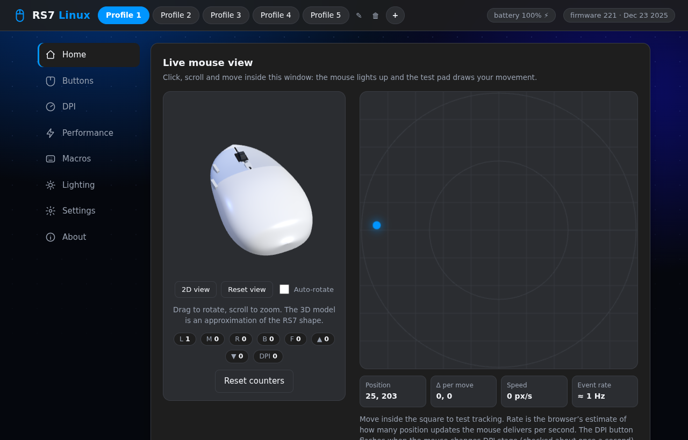
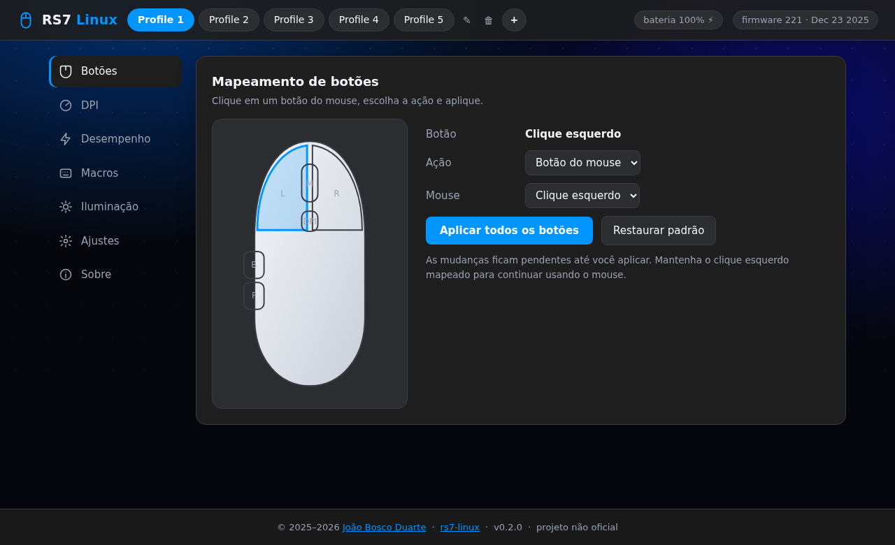
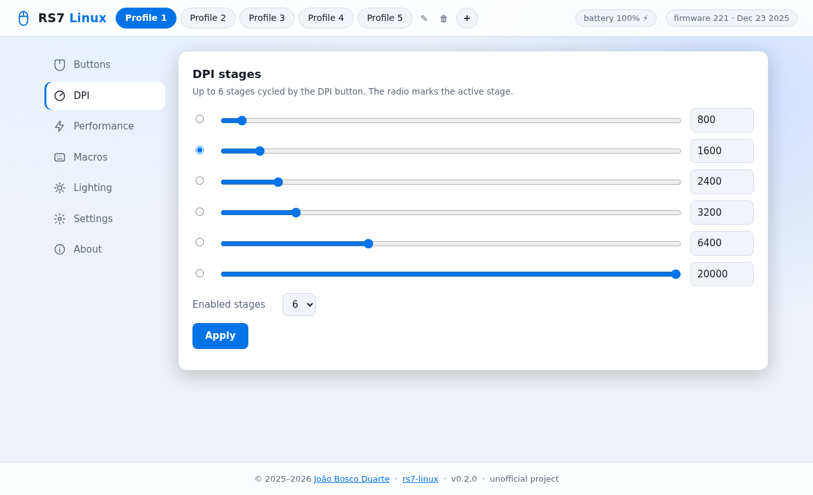
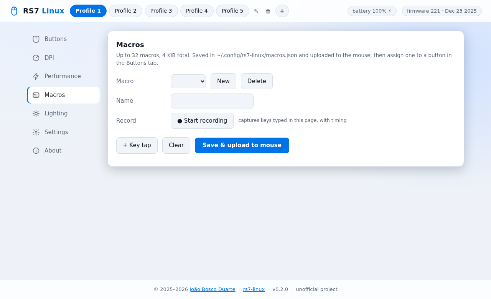

# rs7-linux

Unofficial Linux configurator for the **Smailwolf RS7** gaming mouse (YJX chip, USB `a8a4:2255` / 2.4G dongle `a8a5:2255`).
The vendor only ships a Windows driver and a Chrome/Edge WebHID page; this project talks to the mouse directly through `hidraw`, with a small local web UI and a CLI. No dependencies beyond Python 3.9+.

> Not affiliated with Smailwolf / YJX. Protocol was reverse-engineered from the vendor's own tools for interoperability. Use at your own risk — see [Safety](#safety).

## Features

| Feature | Status |
|---|---|
| Firmware / battery info | verified on hardware |
| DPI: 6 stages (100–20000), enabled count, active stage | verified |
| Polling rate (125/250/500/1000 Hz) | implemented (USB cable mode may be locked to 1000 Hz) |
| Lift-off distance, debounce, sleep time, scroll direction, e-sports mode, sensor options | implemented, read-back verified |
| Lighting mode (off / steady / breathing) | verified |
| Button remapping (mouse, keyboard keys + modifiers, media, DPI loop, disable) | verified (write + read-back) |
| Macros (record/edit up to 32, bind to a button: repeat N / while held / until click) | upload + binding verified by read-back; the macro *playing* on a button press has not been checked on hardware yet |
| Home: rotatable 3D mouse (drag to rotate, scroll to zoom; procedural approximation, 2D fallback) whose buttons/wheel light up as you click/scroll, click counters, DPI button flashes on stage change + movement test pad with trail, speed and event-rate estimate | UI-tested with synthetic events; try it with your mouse |
| Profiles: 5 by default, `+` to add more (up to 20), rename/delete; every change is saved into the active profile | verified on hardware |
| English + Português (Brasil), light/dark/auto theme | UI-tested |
| Tray icon (battery %, profile switcher, open app) via StatusNotifierItem — GNOME, KDE, XFCE, Cinnamon, MATE… | registration + menu + profile switching verified on GNOME/Wayland; other desktops use the same standard protocol |
| Per-stage DPI LED colours | not possible: tested, the firmware does not store them (the vendor web tool does not offer them either) |

## Screenshots


Dark theme (Portuguese) and light theme (English) — language and theme are switchable in Settings.





## Install

```sh
git clone https://github.com/JoaoBoscoDuarte/rs7-linux && cd rs7-linux
./install.sh          # udev rule (sudo) + `rs7` command for your user
```
Re-plug the mouse, then:

```sh
rs7 gui               # opens the UI at http://127.0.0.1:7777
rs7 info              # firmware + battery
rs7 show              # current config as JSON
rs7 dpi 2 1600        # set DPI stage 2
rs7 set report_rate 3 # 0..3 = 125/250/500/1000 Hz
rs7 light breathing
rs7 profile list      # software profiles; `rs7 profile apply "Profile 2"`
rs7 tray              # panel icon with battery + profile switcher (also: Settings → Tray icon)
```

### Tray icon
Needs only PyGObject (`python3-gi`, already present on GNOME/KDE desktops). KDE, XFCE, Cinnamon, MATE and Budgie show it natively. **GNOME** hides tray icons unless the *AppIndicator and KStatusNotifierItem Support* extension is enabled (Ubuntu ships it enabled; Debian: `sudo apt install gnome-shell-extension-appindicator`, then enable it). Turn it on in **Settings → Tray icon**: it starts now and at every login.

Without installing: `python3 -m rs7 gui` from the repo (the udev rule is still required so your user can open `/dev/hidraw*`).

## Safety
Every write is a read-modify-write of the mouse's own config block, followed by a read-back check. Only commands seen in the vendor tools are ever sent; unknown commands are never probed. Settings live in the mouse's flash, so they persist across reboots and OSes. The web UI listens on `127.0.0.1` only and rejects foreign `Host` headers/cross-site POSTs.

## How it works
See [docs/PROTOCOL.md](docs/PROTOCOL.md). Contributions (other firmware variants, macros, colours) welcome: [CONTRIBUTING.md](CONTRIBUTING.md).

## Development
`python3 -m unittest discover -s tests -t .` — protocol tests run without hardware.

License: MIT. The 3D view bundles [three.js](https://threejs.org) r170 (MIT) in `rs7/web/vendor/`, so the app works offline.
